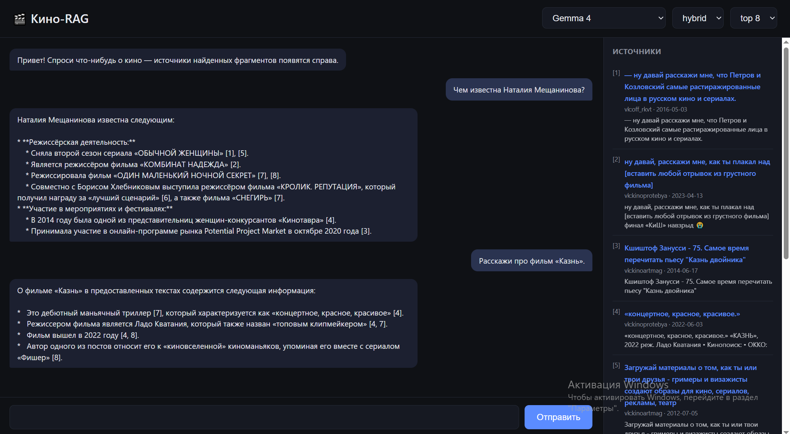
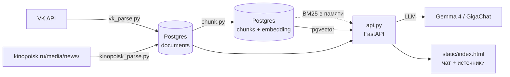

# 🎬 Кино-RAG

RAG-система для работы с постами ВКонтакте и новостями Кинопоиска: **собрал контент → нашёл релевантные фрагменты →
получил ответ со ссылками на источники**. Источники данных — 5 VK-пабликов про кино (38k+ постов) + новости
kinopoisk.ru/media/news/ (2k+ статей), поиск гибридный (BM25 + pgvector), хранилище — Postgres (Docker), генерация —
через Ollama (облачная `gemma4:cloud`) или GigaChat (на выбор), простой чат-UI поверх FastAPI.


<!-- скриншот интерфейса — чат слева, источники справа -->


## Архитектура



**Ретривер — гибридный**: BM25 (точные совпадения слов) + векторный поиск через pgvector (семантический поиск,
`paraphrase-multilingual-MiniLM-L12-v2`) объединяются через Reciprocal Rank Fusion с весом 0.7/0.3 в пользу BM25 — на
именных запросах («какой фильм у актёра X», «фильмы режиссёра Y») маленькая embedding-модель плохо различает
конкретные имена, BM25 их ловит точно; на смысловых запросах без общих слов («фильмы про космос») лучше работает
вектор. Вместе — заметно лучше любого из них по отдельности (см. [Оценка качества](#оценка-качества)).

**Хранилище — Postgres + pgvector** (локально через Docker, см. ниже): документы, чанки и сами векторы (колонка
`chunks.embedding`, HNSW-индекс) живут в одной базе — не нужно синхронизировать отдельный файл-индекс с содержимым
БД, как было раньше с SQLite+FAISS.

## Возможности

- **Сбор с двух источников**:
  - VK: `wall.get` VK API постранично по всей истории стены (не упирается в потолок листинга сайта/канала) — дедуп
    по `url` и `sha256(текст)`, инкрементальная загрузка новых пабликов без повторной загрузки уже собранных
    (`--skip-existing`).
  - kinopoisk.ru/media/news/: обычный HTTP-парсинг (страница отрендерена на сервере, JS не нужен) — листинг до
    `--max-pages` страниц, тело статьи/дата/заголовок вытаскиваются по `itemprop`-атрибутам.
- **Очистка текста**: разметка ВК (`[url|подпись]`), голые ссылки, хэштеги.
- **Чанкинг**: по границам предложений/абзацев, не абы как по словам; перехлёст между соседними чанками.
- **Индекс**: BM25 (без внешних зависимостей, строится в памяти) + pgvector (локальная embedding-модель, без
  Ollama/GigaChat/ключей — только сама БД).
- **Гибридный поиск** с настраиваемым весом BM25/вектора, фильтром по источнику (`vk:kinoprotebya`,
  `kinopoisk:news` и т.п.) — фильтр уходит прямо в SQL, без костыля с oversampling.
- **`/ask`**: экстрактивный ответ без LLM (топ-фрагменты + источники) или генерация через Ollama/GigaChat с
  обязательным цитированием источников по номерам и честным «не нашёл» вместо выдумывания.
- **Оценка качества**: Hit@K / Recall@K через LLM-as-judge — без ручной разметки эталона, плюс скрипт
  автогенерации тестовых вопросов прямо из корпуса (`scripts/gen_test_prompts.py`).
- **UI**: простой чат (без сборки/npm, один HTML-файл) с источниками справа и живыми ссылками на посты.

## Стек

| Слой | Инструмент |
|---|---|
| Сбор данных | VK API, HTTP-парсинг kinopoisk.ru (`requests` + `beautifulsoup4`) |
| Хранилище | Postgres (Docker, `docker-compose.yml`) |
| Текстовый поиск | BM25 (собственная реализация) |
| Векторный поиск | pgvector (HNSW) + fastembed (`paraphrase-multilingual-MiniLM-L12-v2`, ONNX/CPU) |
| LLM | Ollama (облачные модели, `gemma4:cloud`) или GigaChat API |
| Backend | FastAPI + uvicorn |
| Frontend | HTML/CSS/JS, без сборки |
| Конфигурация | `.env` + `python-dotenv` |


## Запуск

```bash
# 1. Postgres + pgvector в Docker (данные переживают перезапуск контейнера — volume)
docker compose up -d

# 2. зависимости
pip install -r requirements.txt

# 3. секреты/конфиг — скопировать и заполнить (VK-токен, ключи LLM; POSTGRES_* можно
# оставить по умолчанию, они совпадают с docker-compose.yml)
cp .env.example .env

# 4. собрать данные (любой из источников или оба)
python -m scripts.vk_parse
python -m scripts.kinopoisk_parse --keep-db --skip-existing

# 5. нарезать на чанки и посчитать эмбеддинги
python -m rag.chunk
python -m rag.embed_index

# 6. готово — поиск/вопрос/сервер
python -m rag.search "фильмы про космос" --engine hybrid
python -m rag.ask "вопрос" --llm ollama
uvicorn rag.api:app --reload   # http://127.0.0.1:8000
```

## Структура проекта

```
rag/                        # пайплайн и API
    config.py                   # .env -> dataclass-конфиги (Postgres/Ollama/GigaChat/VK)
    storage.py                  # Postgres: схема documents + дедуп-запись
    text_clean.py                # чистка разметки ВК/ссылок из текста поста
    chunk.py                     # documents -> chunks (нарезка по предложениям)
    embed_index.py               # chunks -> эмбеддинги в chunks.embedding (pgvector)
    stopwords_ru.py              # стоп-слова для BM25-токенизации
    search.py                    # BM25 + pgvector + RRF-гибрид, переиспользуемый ретривер
    ask.py                       # ретривер -> контекст -> LLM (Ollama/GigaChat) или экстрактивный ответ
    api.py                       # FastAPI: /search, /ask, /health + статика UI
scripts/                     # отдельные CLI-утилиты, не часть пайплайна при запуске сервера
    vk_parse.py                   # сбор постов VK API -> documents
    kinopoisk_parse.py             # сбор новостей kinopoisk.ru/media/news/ -> documents
    gen_test_prompts.py            # автогенерация тестовых вопросов из корпуса (для eval_recall)
    eval_recall.py                 # Hit@K/Recall@K через LLM-as-judge
    run_prompts.py                 # массовый прогон списка промптов через ask.answer()
    clean_existing.py              # ретроактивная чистка текста в уже собранных documents
static/index.html            # чат-интерфейс (без сборки)
docker-compose.yml            # локальный Postgres + pgvector
```

Все команды запускаются из корня репозитория как модули: `python -m rag.search ...`,
`python -m scripts.vk_parse ...`, `uvicorn rag.api:app --reload`.
Полный список флагов — `python -m rag.<модуль> --help` / `python -m scripts.<модуль> --help`.

## Оценка качества

`eval_recall.py` считает Hit@K/Recall@K без ручной разметки эталона: для каждого тестового вопроса берётся пул из
топ-10 кандидатов ретривера, LLM-судья (та же модель Ollama) размечает каждый фрагмент как релевантный или нет с
коротким обоснованием — так метрику можно выборочно перепроверить по JSON-выгрузке.

Два набора вопросов: 20 написанных руками (`test_prompts.txt`, конкретные факты о российском кино) и 120
автосгенерированных прямо из корпуса, поровну по каждому источнику (`test_prompts_auto.txt`,
`scripts.gen_test_prompts`):

| K | hand-written (20), hit / recall | авто (120), hit / recall |
|---|---|---|
| 1 | 0.35 / 0.12 | 0.44 / 0.36 |
| 3 | 0.60 / 0.42 | 0.69 / 0.66 |
| 5 | 0.75 / 0.62 | 0.80 / 0.83 |
| 10 | 0.85 / — * | 0.85 / — * |

\* Recall@10 не показан: пул судьи сам по себе размером 10, так что при K=10 recall по построению всегда 1.0 — это
артефакт методики (K совпал с размером пула), а не сигнал о качестве ретривера.

Авто-набор размечен выше: он сгенерирован прямо из документов корпуса, то есть ответ гарантированно существует —
это проверка механики поиска, а не того, насколько система полезна на непредсказуемых вопросах реального
пользователя (для этого ближе hand-written набор). Разница между наборами — хороший индикатор именно пробелов в
покрытии корпуса, а не слабости ретривера.

## Известные ограничения

- **Покрытие корпуса.** 5 VK-каналов больше про фестивальное/артхаусное кино и киножурналистику; kinopoisk-новости
  добавляют более мейнстримный срез, но полных пресс-релизов (актёрский состав, продюсеры) по блокбастерам всё
  равно не хватает на часть вопросов — система честно отвечает «не нашёл», когда факта в источниках нет.
- **Маленькая embedding-модель** (384-мерная, ~225 МБ) слабо различает конкретные имена собственные — отдельно
  вектор проигрывает BM25 на именных запросах; гибрид с весом 0.7 в пользу BM25 компенсирует это на практике.
- **LLM-as-judge без ручной проверки.** Метрики Hit@K/Recall@K получены LLM-судьёй, без человеческой разметки и без
  проверки согласованности судьи самого с собой — это proxy-метрика, не строгая оценка (см. таблицу выше и оговорку
  про recall@10).
- **Нет метрик ранжирования/точности.** Hit/Recall отвечают «нашли ли релевантное где-то в топ-K», но не измеряют
  точность (сколько шума попадёт в контекст LLM) или качество ранжирования (precision@K, MRR, NDCG).
